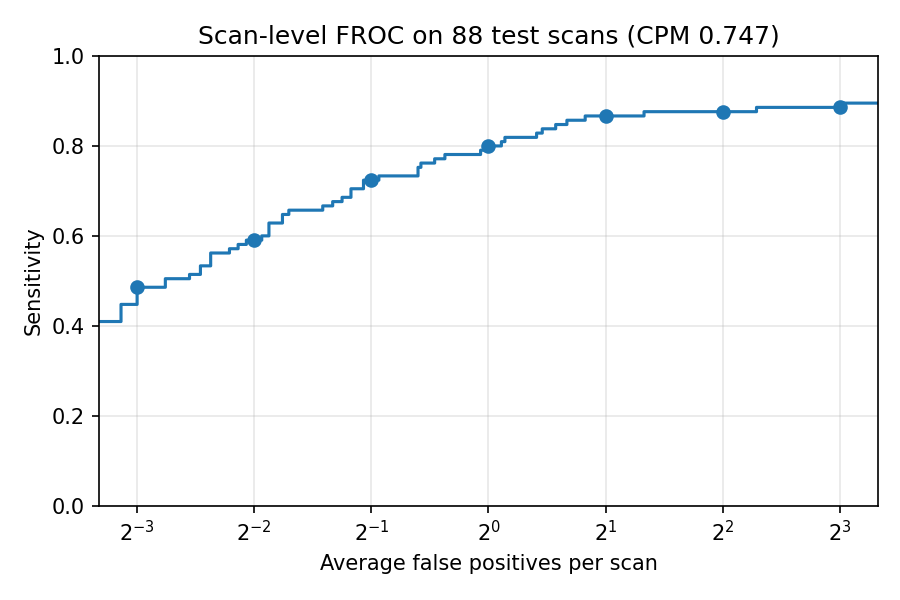

# Lung Nodule Detection

[](https://github.com/jonahernan99/lung-nodule-detection/actions/workflows/ci.yml)


**An independent reimplementation of my B.Eng. thesis on detecting lung nodules
in CT scans, rebuilt with a stricter, scan-level evaluation.**

> **Status:** first full training run done. On 88 held-out LUNA16 scans the
> detector reaches a **CPM of 0.747** (95% CI 0.690–0.801) with false positives
> counted per scan. See [Results](#results). Next: a run comparing the single-slice
> input with a [2.5D input](#25d-input-experiment) built for small nodules, then
> Eigen-CAM.

## Background

Lung nodules are the main early indicator of lung cancer, and radiologists can
miss around a quarter of them in CT scans. For my thesis at the
[BIVL²ab lab](https://noesis.uis.edu.co/entities/publication/4b44ab5b-d4e8-49c6-8d12-509ff69b15f4),
Universidad Industrial de Santander (2023), I adapted YOLOv5s to localize
nodules on 2D CT slices from LIDC-IDRI. Dylan Villalba led the Eigen-CAM
explainability work, and the project was advised by Prof. Fabio Martínez and
Prof. Franklin Sepúlveda. The original code stayed with the lab; this
repository is new code written from scratch.

### What this reimplementation changes

| | Thesis (2023) | This repository |
| --- | --- | --- |
| Data split | Mostly by 2D slice | By scan, using LUNA16's ten official subsets |
| False-positive rate in FROC/CPM | Per slice | Per scan, as in the LUNA16 challenge |
| Code | Kept by the lab | Open source, tested, with CI |

Splitting by slice lets nearly identical neighbouring slices of the same scan
land in both training and test sets, which inflates results. Rates per slice
are also far more lenient than per scan, since one CT scan has around 200
slices. The thesis reported **88.0% CPM** under those conditions. Expect this
repository's numbers to come out lower and more realistic, and both will be
reported side by side with their evaluation protocols.

## Results

First full run on a free Kaggle GPU with
[`notebooks/kaggle_train.ipynb`](notebooks/kaggle_train.ipynb) (v0.4.0): trained
on LUNA16 subsets 0–7, model selection on subset 8, tested once on subset 9
(88 scans, 105 nodules). Ultralytics YOLOv5s (`yolov5su`, anchor-free head),
512 px slices, 100 epochs, evaluated with the best validation checkpoint.

| FP per scan | 0.125 | 0.25 | 0.5 | 1 | 2 | 4 | 8 | **CPM** |
| --- | ---: | ---: | ---: | ---: | ---: | ---: | ---: | ---: |
| Sensitivity | 0.486 | 0.590 | 0.724 | 0.800 | 0.867 | 0.876 | 0.886 | **0.747** |

- **95% confidence interval for the CPM: 0.690–0.801**, from 1,000 bootstrap
  resamples of the test scans (`lungnodule.froc.bootstrap_cpm`). One fold of
  88 scans leaves this much uncertainty, so the interval is reported with the
  CPM.
- At one false positive per scan, the detector finds 80% of the nodules. 101 of
  the 105 nodules are found at some confidence; 4 are never detected.
- **Checked independently:** re-scoring the run's 6,311 candidates offline with
  `compute_froc` and with the port of the official LUNA16 algorithm gives the
  same seven sensitivities. Numbers and settings are in
  [`results/luna16-subset9/summary.json`](results/luna16-subset9/summary.json),
  and the candidates in
  [`results/luna16-subset9/candidates.csv`](results/luna16-subset9/candidates.csv),
  so anyone can re-score them with the official script or with
  `lungnodule score` (see [Score a candidates file](#score-a-candidates-file)).



### Detection by nodule size

The CPM averages over every nodule. Broken down by size
([`by_size.json`](results/luna16-subset9/by_size.json)), the weak spot is clear:

| Nodule size | Nodules | Found at 1/8 FP per scan | Found at 1 FP per scan | Found at 8 FP per scan |
| --- | ---: | ---: | ---: | ---: |
| Under 6 mm | 45 | 16 (36%) | 31 (69%) | 38 (84%) |
| 6–10 mm | 34 | 18 (53%) | 29 (85%) | 31 (91%) |
| 10–20 mm | 20 | 11 (55%) | 18 (90%) | 18 (90%) |
| 20 mm or more | 6 | 6 (100%) | 6 (100%) | 6 (100%) |

Small nodules are 43% of the test set and account for most of the misses: at
one false positive per scan, 14 of the 21 missed nodules are under 6 mm. On a
512 px slice such a nodule spans only a few pixels, and it appears on few
slices, so a 2D detector has little to go on. Larger inputs or a 2.5D input that stacks
neighbouring slices are the natural experiments to target it; the
[2.5D input](#25d-input-experiment) is implemented and awaiting a run. The groups above
6 mm are small (6 to 34 nodules), so their percentages are rough.

### Compared with the thesis

| | Thesis (2023) | This repository |
| --- | --- | --- |
| Data split | Mostly by 2D slice (LIDC-IDRI) | By scan: LUNA16 subset 9 held out |
| False positives counted | Per slice | Per scan |
| Model | YOLOv5s, anchor-based, tuned anchors | YOLOv5s, Ultralytics anchor-free head |
| CPM | 88.0% | **74.7%** (95% CI 69.0–80.1%) |

The two numbers are not directly comparable, and the drop is expected. A scan
has around 200 slices, so "1 false positive per slice" allows about 200 per
scan; here it allows one. The held-out scans also share no slices with
training. The 74.7% is the honest estimate of how this 2D approach performs on
unseen scans. (This run split by scan without the optional patient check;
LIDC-IDRI has a few patients with more than one scan.) It is still well below
leading LUNA16 systems, which use 3D context and report averages over all ten
folds.

### Training curves


Training losses fall steadily, but validation losses reach their minimum
around epochs 25–45 and then rise, while validation mAP peaks near epoch 35 and
slowly declines: the model starts to overfit. Because `best.pt` keeps the best
validation epoch, the evaluated model is not the overfit final one, but the
second half of training spent GPU time without improving it. The notebook now
stops training 20 epochs after the best validation fitness (`PATIENCE`).

### 2.5D input (experiment)

A 2D detector sees one slice at a time. A small nodule and a vessel can look
the same there: the difference is in depth, where a vessel continues through
neighbouring slices and a nodule appears and fades within a few millimetres.
`--input stack` puts the slices about 2 mm on either side in the red and blue
channels, with the labeled slice in green, so the same YOLO network gets that
context without any change to its architecture.

- The distance is set in millimetres (`--stack-mm`) and converted per scan,
  since LUNA16 slice spacing ranges from about 0.6 to 2.5 mm. At 2 mm, a 6 mm
  nodule still crosses both neighbours.
- The choice is saved in `dataset/preprocessing.json` and read back by
  `evaluate`, so a model is always evaluated on the kind of image it was
  trained on.
- Ultralytics reads training images in BGR order and treats arrays passed to
  `predict` as BGR too, so the detector adapter reverses the stacked channels
  before predicting; a test checks that the two paths give the same array.
- Hue and saturation augmentation would mix the channels, so the notebook turns
  them off in `stack` mode.

The comparison will be two full Kaggle runs on the same split with early
stopping, one with `INPUT_MODE = "gray"` and one with `"stack"`, reported with
CPM intervals and the size breakdown. No result is claimed until then.

## What is implemented

- **`lungnodule.froc`**: scan-level FROC curve and CPM (mean sensitivity at
  1/8 to 8 false positives per scan) using the LUNA16 hit criterion, with
  support for excluded findings.
- **`lungnodule.annotations`**: readers for LUNA16 annotation and candidate CSV
  files.
- **`lungnodule.geometry`**: conversion between world coordinates (mm) and
  voxel indices, including scans with flipped axes.
- **`lungnodule.preprocess`**: reads `.mhd` scans, applies a lung window and
  exports 2D slices with YOLO labels, as gray images or as 2.5D stacks of
  neighbouring slices. Each box is sized to the nodule's
  cross-section on that slice. Background slices are sampled only from slices
  that do not touch any nodule, so a barely visible nodule is never taught as
  background.
- **`lungnodule.folds`**: splits scans by LUNA16 subset and checks, using
  LIDC-IDRI metadata, that no patient has scans in more than one split.
- **`lungnodule.dataset`** and the **`lungnodule build-dataset`** command:
  export a ready-to-train YOLO dataset with an Ultralytics `data.yaml`. Test
  scans are only listed in `splits.csv`, because scan-level evaluation runs
  the detector on every slice of each test scan.
- **`lungnodule.inference`**: runs any 2D detector over every slice of a scan,
  with an adapter for trained Ultralytics YOLO weights.
- **`lungnodule.candidates`**: merges detections of the same nodule on
  neighbouring slices into one 3D candidate in world coordinates, so a nodule
  seen on five slices is not counted as four false positives.
- **`lungnodule.breakdown`** and the **`lungnodule score`** and
  **`lungnodule breakdown`** commands: score any candidates file and report
  detected nodules by size at chosen false-positive rates.
- **`lungnodule.evaluation`** and the **`lungnodule evaluate`** command:
  scan-level FROC/CPM on whole test scans, writing `candidates.csv` in the
  LUNA16 submission format and `froc.json`, including a bootstrap confidence
  interval for the CPM.

### Matching the official LUNA16 evaluation

The metric is validated against the challenge's own evaluation code,
`noduleCADEvaluationLUNA16.py`, in three ways:

1. **Rules checked line by line:** a candidate hits a nodule only when it is
   strictly within the nodule's radius, findings without a recorded size count
   as 10 mm wide, a nodule found by several candidates counts once, candidates
   on excluded findings are ignored, and sensitivities are interpolated along
   the curve.
2. **Same numbers on the official example.** The evaluation package ships a
   sample submission and the FROC curve the official script produced for it.
   [`scripts/validate_official.py`](scripts/validate_official.py) evaluates the
   same 551,065 candidates over 888 scans:

   | FP/scan | 0.125 | 0.25 | 0.5 | 1 | 2 | 4 | 8 |
   | --- | ---: | ---: | ---: | ---: | ---: | ---: | ---: |
   | Official curve | 0.000000 | 0.000843 | 0.000843 | 0.001686 | 0.004216 | 0.007589 | 0.016020 |
   | This code | 0.000000 | 0.000843 | 0.000843 | 0.001686 | 0.004216 | 0.007589 | 0.016020 |

   The largest difference is 4e-10, and the found nodules (1,120) and
   duplicate detections (231) match the official report exactly. The sample
   is a deliberately weak submission, so its CPM is near zero.
3. **Same results as a port of the official algorithm** on 20 random cases
   with tied probabilities, excluded findings and negative diameters
   ([`tests/test_froc_official.py`](tests/test_froc_official.py)).

One documented discrepancy: the official example report ignores 1,294
candidates on excluded findings, while the script shipped next to it, and this
code, ignore 6,555. The difference is fully explained by the 10 mm rule for
findings without a size: with negative diameters taken literally, this code
reproduces the report's counts exactly (1,294 ignored, 548,420 false
positives), so the report was produced by an earlier version of the script.
The official script is Python 2 and does not run as is on Python 3.

### Train and evaluate on Kaggle

[`notebooks/kaggle_train.ipynb`](notebooks/kaggle_train.ipynb) runs the whole
pipeline on a free Kaggle GPU with the `vafaeii/luna16` dataset attached: build
the dataset, train YOLOv5s and evaluate per scan. It starts in `QUICK_RUN`
mode, a short smoke test, before a full run. `INPUT_MODE` chooses the gray or
the 2.5D input, and `PATIENCE` sets early stopping. The model is Ultralytics'
YOLOv5s variant with an anchor-free head, so it differs from the thesis, which
used the original anchor-based YOLOv5s with tuned anchors.

### Score a candidates file

Any CSV in the LUNA16 submission format can be scored without images or a GPU:

```bash
lungnodule score --candidates results/luna16-subset9/candidates.csv \
  --annotations annotations.csv --excluded annotations_excluded.csv \
  --scans results/luna16-subset9/test_scans.txt      # CPM 0.7469 (95% CI 0.690-0.801)
lungnodule breakdown --candidates results/luna16-subset9/candidates.csv \
  --annotations annotations.csv --excluded annotations_excluded.csv \
  --scans results/luna16-subset9/test_scans.txt --fp-rate 0.125 1 8 --out by_size.json
```

`--scans` lists every evaluated scan, so scans without any candidate still
count towards false positives per scan.

### Build the training data

```bash
pip install -e ".[data]"
lungnodule build-dataset \
  --luna-root path/to/luna16 \          # folder containing subset0 ... subset9
  --annotations path/to/annotations.csv \
  --out dataset \
  --test-subset 9 --val-subset 8 \
  --patients path/to/lidc_metadata.csv  # optional: stop if a patient leaks
```

Add `--max-scans 20` for a quick first run on a free GPU, and `--input stack`
(optionally `--stack-mm 2`) for the [2.5D input](#25d-input-experiment).

```python
from lungnodule.annotations import load_annotations, load_candidates
from lungnodule.froc import compute_froc

result = compute_froc(
    load_candidates("predictions.csv"),
    load_annotations("annotations.csv"),
    scan_ids=test_scan_ids,
)
print(f"CPM: {result.cpm:.3f}", dict(zip(result.fp_rates, result.sensitivities)))
```

```python
from lungnodule.annotations import load_annotations
from lungnodule.preprocess import export_slices, load_scan

nodules = load_annotations("annotations.csv")
scan = load_scan("subset0/<series_uid>.mhd")
export_slices(scan, nodules.get("<series_uid>", []), "<series_uid>", "dataset/train")
```

## Roadmap

- [x] Scan-level FROC/CPM evaluation
- [x] LUNA16 annotation readers and coordinate conversion
- [x] Preprocessing: read `.mhd` scans, apply a lung window and export slices with YOLO labels
- [x] Fold assignment from LUNA16 subsets, checking that no patient appears in two folds
- [x] `build-dataset` command producing an Ultralytics-ready dataset
- [x] Training notebook for a free cloud GPU (Kaggle)
- [x] Merge 2D slice detections into 3D candidates per scan
- [x] Hit criterion checked against the official LUNA16 evaluation script
- [x] FROC validated numerically against the official example evaluation
- [x] Results: FROC curve and CPM with a confidence interval, compared with the thesis
- [x] Sensitivity by nodule size (small nodules are the main weakness)
- [x] Early stopping in the training notebook
- [ ] Augmentation study (validation loss rises after epoch ~35)
- [ ] Eigen-CAM explainability maps
- [x] 2.5D input option: neighbouring slices as color channels
- [ ] Kaggle runs comparing gray and 2.5D input
- [ ] All ten LUNA16 folds, to report a cross-validated CPM

## Data

The model is trained on [LUNA16](https://luna16.grand-challenge.org/Data/),
a curated subset of LIDC-IDRI with 888 CT scans and 1,186 nodules accepted by at
least three of four radiologists. Medical images are never committed to this
repository. Download them from the official source and follow their terms of
use.

## Development

```bash
pip install -e ".[dev]"   # includes SimpleITK and Pillow for the data tools
ruff check . && ruff format --check .
pytest --cov=lungnodule
```

## License

[AGPL-3.0](LICENSE), because the detector is built on Ultralytics YOLO, which
uses this license.
